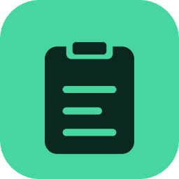
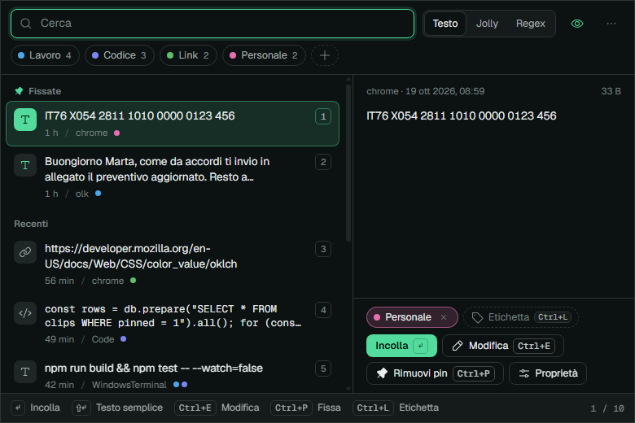
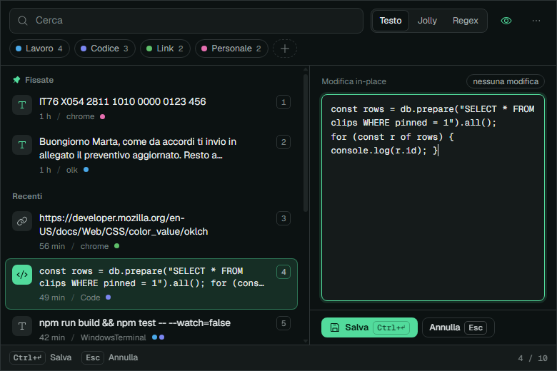
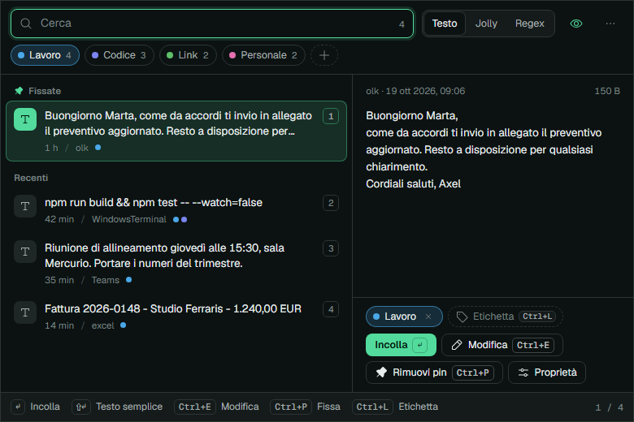
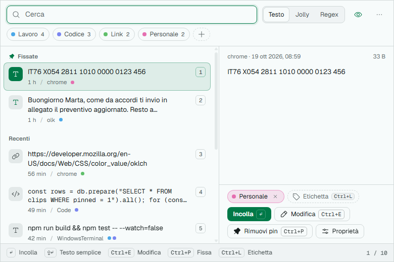
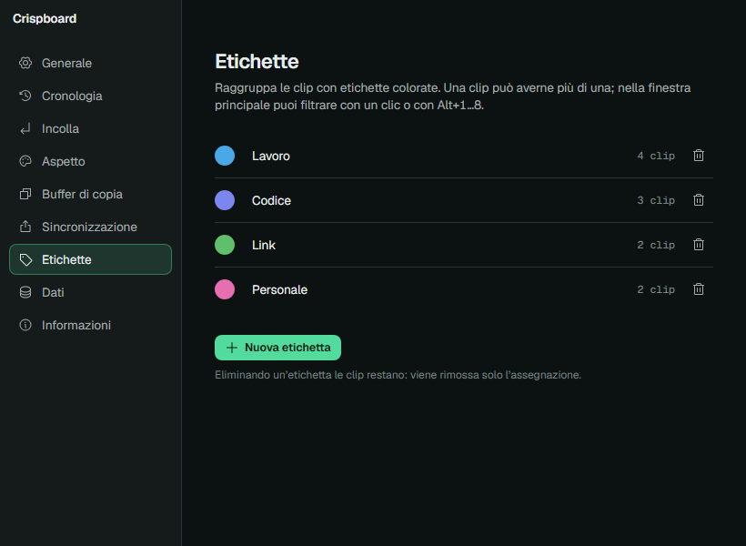

<div align="center">



# Crispboard

**Un gestore di clipboard veloce, pensato per la tastiera, per Windows.**
Tutto ciò che copi, a una scorciatoia di distanza: cercalo, modificalo, etichettalo, fissalo, incollalo.

[](https://github.com/Axeru19/crispboard/actions/workflows/ci.yml)
[](LICENSE)


[Scarica](https://github.com/Axeru19/crispboard/releases) · [English](README.md) · [Changelog](CHANGELOG.md) · [Contribuire](CONTRIBUTING.md)



</div>

---

> **Alpha.** Crispboard è in alpha: nei test funziona, ma aspettati bug e modifiche incompatibili. Fai un backup della cronologia (Impostazioni → Dati) prima di aggiornare e [segnala i problemi](https://github.com/Axeru19/crispboard/issues).

## Perché Crispboard

Crispboard rifà da zero il nucleo di [Ditto](https://github.com/sabrogden/Ditto), lo storico gestore di clipboard per Windows, con un'interfaccia moderna e tre funzioni che Ditto non ha:

| | |
|---|---|
| **Modifica sul posto** | Correggi una clip direttamente nel pannello di anteprima, senza editor esterni. Salva con `Ctrl+Invio`, annulla con `Esc`. |
| **Etichette colorate** | Organizza le clip con etichette colorate, anche più di una per clip. Filtra con un clic o `Alt+1…8`. |
| **Pin che restano** | Le clip fissate stanno in cima e **non** vengono mai eliminate da limite di cronologia, scadenza o "elimina non usate". |

<p align="center">
  
  
</p>

## Funzioni

- **Cattura tutto**: testo, HTML, RTF, immagini, file copiati. Ogni formato viene salvato, così incollando mantieni la formattazione.
- **Ricerca istantanea**: testo semplice, caratteri jolly (`*`, `?`) o espressioni regolari, con evidenziazione.
- **Una scorciatoia globale** (`Ctrl+Alt+V` di default). La finestra si apre accanto al cursore di testo e incolla nell'app che stavi usando.
- **Tastiera prima di tutto**: frecce, `Invio` per incollare, `Maiusc+Invio` per testo semplice, `Ctrl+1…0` per le prime dieci clip.
- **Incolla speciale**: MAIUSCOLO, minuscolo, Iniziali, Frase, camelCase, slug, su una riga, senza spazi, solo ASCII, aggiungi data e ora e altro.
- **Incolla multiplo** con separatore configurabile.
- **Buffer di copia**: tre slot indipendenti con scorciatoie globali di copia, taglia e incolla.
- **Privacy**: ignora i contenuti segnati come privati dai gestori di password e ha un elenco di app escluse (KeePass, 1Password, Bitwarden, LastPass, Dashlane già inclusi). Sospendi la cattura dal tray quando vuoi.
- **Sincronizzazione in LAN**: invia clip ad altri PC della rete, cifrate (AES-256-GCM) con password condivisa. Disattivata di default.
- **Controllo della cronologia**: numero massimo, scadenza in giorni, duplicati, dimensione massima.
- **Backup, export, import**: export JSON con etichette e pin, backup e ripristino SQLite.
- **Chiaro e scuro**: segue Windows, oppure scegli tu.

<p align="center">
  
  
</p>

## Installazione

### Download (consigliato)

1. Scarica `Crispboard-win-x64.zip` dall'[pagina delle release](https://github.com/Axeru19/crispboard/releases).
2. Estrailo dove vuoi ed esegui `Crispboard.exe`.
3. Premi `Ctrl+Alt+V`.

L'eseguibile non è ancora firmato: al primo avvio SmartScreen può avvisare (*Ulteriori informazioni → Esegui comunque*). Attiva *Avvia con Windows* nelle Impostazioni per averlo sempre pronto.

### Compilare dai sorgenti

Requisiti: Windows 10/11 x64 e [Node.js](https://nodejs.org) 24 o superiore.

```powershell
git clone https://github.com/Axeru19/crispboard.git
cd crispboard
npm install
npm start               # avvio in sviluppo
npm run dist            # crea dist\win-unpacked\Crispboard.exe
```

## Scorciatoie

| Azione | Tasti |
|---|---|
| Apri / chiudi | `Ctrl+Alt+V` (configurabile) |
| Naviga | `↑` `↓` `PagSu` `PagGiù` |
| Incolla | `Invio`, doppio clic, `Ctrl+1…9,0` per le prime dieci |
| Incolla come testo semplice | `Maiusc+Invio` |
| Incolla speciale | clic destro → *Incolla speciale* |
| Cerca | scrivi · modalità Testo / Jolly / Regex |
| Modifica sul posto | `Ctrl+E` o `F2` · salva `Ctrl+Invio` · annulla `Esc` |
| Fissa / sblocca | `Ctrl+P` |
| Etichette | `Ctrl+L` (scrivi per filtrare o creare) · filtro `Alt+1…8` |
| Riordina | `Alt+↑` `Alt+↓` |
| Elimina | `Ctrl+D` o `Canc` |
| Nuova clip | `Ctrl+N` |
| Selezione multipla | `Maiusc+↑/↓`, `Ctrl+clic` |
| Anteprima | `F3` |
| Impostazioni | `Ctrl+,` |

## Privacy e sicurezza

- Tutto resta sul tuo PC, in `%APPDATA%\Crispboard\crispboard.db` (SQLite). **La cronologia è salvata in chiaro**, come in Ditto: usa l'elenco di app escluse per gli strumenti sensibili.
- Nessuna telemetria e nessun accesso di rete, a meno che tu non attivi la sincronizzazione LAN.
- La sincronizzazione apre una porta TCP (23443 di default) solo se attiva e scarta tutto ciò che non è cifrato con la tua password condivisa. Usala solo su reti fidate.
- L'interfaccia gira in un renderer isolato (sandbox, context isolation, canali IPC in whitelist).

Hai trovato una vulnerabilità? Leggi [SECURITY.md](SECURITY.md).

## Come funziona

Guscio Electron, SQLite tramite `node:sqlite` e chiamate Win32 dirette con [koffi](https://koffi.dev) per clipboard, posizione del cursore, ripristino del focus e tasti sintetici. Nessun framework nel renderer: JS e CSS con token OKLCH.

Electron 44 ha reso asincrona l'API clipboard e ha tolto i formati arbitrari: Crispboard legge e scrive quindi la clipboard di Windows direttamente.

Approfondimenti: [`docs/design-system.md`](docs/design-system.md) · [`docs/ditto-analysis.md`](docs/ditto-analysis.md) (analisi delle funzioni e matrice di parità con Ditto).

## Sviluppo

```powershell
npm test         # test unitari
npm run e2e      # end-to-end sull'app reale (clipboard e incolla veri)
npm run icons    # rigenera src/renderer/icons.js da Phosphor
node scripts/screenshots.mjs   # rigenera docs/img
```

`npm run e2e` usa clipboard e focus reali: eseguilo a PC inattivo (circa due minuti).

## Roadmap

Da fare (le PR sono benvenute):

- [ ] Localizzazione inglese (e altre)
- [ ] Diff tra due clip
- [ ] QR code / traduzione / invio email
- [ ] Import di temi e database di Ditto
- [ ] Scorciatoie interne riassegnabili
- [ ] Firma del codice, installer e pacchetto winget
- [ ] Incolla in app eseguite come amministratore

Limiti noti: il consumo di memoria di Electron (alcune centinaia di MB di working set contro decine di Ditto), le bitmap a palette (1/4/8 bit) non vengono catturate se manca anche il formato PNG, e le clip oltre 300 000 caratteri non si modificano sul posto.

## Contribuire

Issue e pull request sono benvenute. Leggi prima [CONTRIBUTING.md](CONTRIBUTING.md).

## Crediti e licenza

[MIT](LICENSE) © Axel Liuzzi.

Crispboard è un progetto indipendente **ispirato a Ditto** di Scott Brogden. Non è affiliato a Ditto e non ne contiene codice: il comportamento di Ditto è stato studiato da funzioni documentate, schema dei dati e file di risorse per definire l'insieme di funzioni.

Realizzato con [Electron](https://www.electronjs.org) (MIT), [koffi](https://koffi.dev) (MIT), [Phosphor Icons](https://phosphoricons.com) (MIT) e il font [Geist](https://vercel.com/font) (SIL OFL 1.1).
